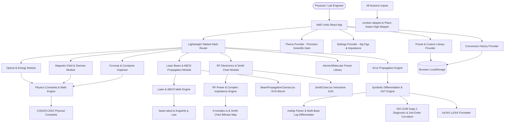
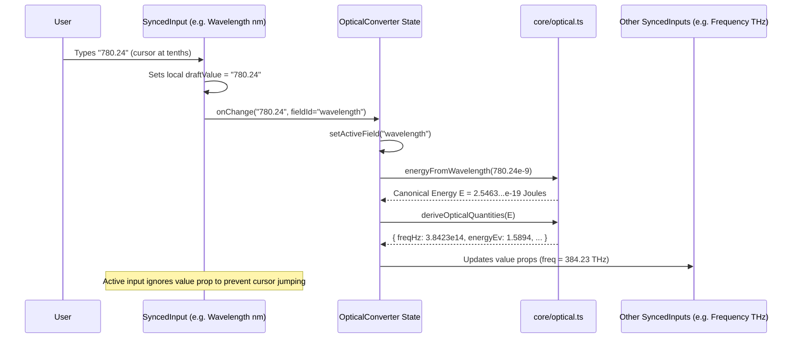

# 🏗️ Architecture & Mathematical Specifications — AMO Units

## 1. System Architecture Overview

AMO Units is an offline-first, client-only Progressive Web Application (PWA). It contains **zero external server dependencies, zero telemetry, and zero remote database calls**, ensuring absolute data confidentiality, instantaneous sub-millisecond execution, and 100% offline functionality in basement laboratories, laser cleanrooms, and Faraday cages.



---

## 2. Tech Stack & Engineering Rationale

| Layer | Technology | Version | Engineering Rationale |
|-------|-----------|---------|-----------------------|
| **Framework** | React + Vite | React 18 / 19, Vite 5+ | Sub-second cold startup, fast HMR, and ultra-lean production bundle footprint (<370 KB gzip including math engines). |
| **Language** | TypeScript | 5.x (Strict mode) | Strict type checking across physical dimensions, SI prefixes, complex impedance structures, ray matrices, and AST nodes. |
| **Styling** | CSS Modules + Custom Design Tokens | Modern CSS | Zero runtime CSS-in-JS overhead; instant theme transitions without flicker or layout reflows. |
| **Symbolic Math** | `mathjs` | 13.x+ | 100% client-side expression parser, AST traversal, analytical symbolic differentiation, and algebraic simplification. |
| **Equation Rendering** | `katex` | Latest | High-performance, offline-bundled LaTeX equation rendering for physical relationships and derived error equations. |
| **Iconography** | `lucide-react` | Latest | Lightweight, tree-shakeable SVG icons for laboratory actions, presets, and controls. |
| **PWA & Offline** | `vite-plugin-pwa` + Workbox | 0.20+ | Cache-First service worker precaching all HTML, JS, CSS, and local KaTeX mathematical woff/woff2 fonts (46 entries, ~2.0 MB). |
| **State & Persistence** | React Context + LocalStorage | Native React | Persistent custom user presets, conversion history, default impedance ($Z_0$), and precision settings without external database overhead. |
| **Test Framework** | Vitest + Testing Library | Vitest 2.x | High-throughput unit, UI component, and zero-trust numerical accuracy verification test suite (23 test files, 365 automated unit tests). |

---

## 3. Project Directory Structure

```
AMO-Units/
├── docs/                        # Complete technical specifications & documentation suite
│   ├── README.md                # Technical documentation index & manifest
│   ├── requirements.md          # Comprehensive functional requirements & acceptance criteria
│   ├── architecture.md          # Architectural models, math derivations & system diagrams
│   ├── design-system.md         # Precision Scientific Dark design tokens & component specs
│   ├── implementation-plan.md   # Phased implementation record (Phases 1-10 complete)
│   └── qa-report.md             # Verification test record & provenance report
├── public/                      # Static assets & offline web application manifest
│   ├── manifest.webmanifest     # PWA standalone manifest
│   └── favicon.svg              # App icon
├── scripts/                     # Tooling & provenance scripts
│   └── generate-wolfram-fixtures.wls # Wolfram Language accuracy benchmark script
├── tests/                       # Verification fixtures & provenance specifications
│   └── fixtures/
│       ├── PROVENANCE.md        # Cryptographic checksums & standards audit trail
│       ├── wolfram-golden-optical.json
│       ├── wolfram-golden-rf-complex.json
│       ├── wolfram-golden-beam-abcd.json
│       ├── wolfram-golden-error-prop.json
│       └── wolfram-golden-presets.json
├── src/
│   ├── assets/                  # App logos and graphical assets
│   ├── constants/
│   │   ├── codata2022.ts        # Official CODATA 2022 fundamental physical constants
│   │   ├── formulas.ts          # 26 documented KaTeX formulas with physical variable metadata
│   │   └── default-presets.ts   # Curated molecular (AlCl, CaF, AlF), alkali, and Sr clock presets
│   ├── core/                    # Pure, side-effect-free scientific math engines
│   │   ├── optical.ts           # Wavelength, frequency, energy, wavenumber, and thermal temp conversions
│   │   ├── zeeman.ts            # Magnetic field, Bohr/nuclear magnetons, Landé g-factor shifts
│   │   ├── laser-beam.ts        # Gaussian beam waist, Rayleigh range, peak/avg intensity, Rabi frequencies
│   │   ├── beam-abcd.ts         # Paraxial ray matrices, Kogelnik q-law, thin/thick lenses, waist detection
│   │   ├── polarization.ts      # Jones calculus, Stokes vectors, Poincaré sphere, waveplates & polarizers
│   │   ├── rf-power.ts          # Scalar RF power & voltage conversions (dBm, W, Vrms, Vpp, attenuation)
│   │   ├── rf-vswr.ts           # Scalar VSWR, reflection coefficient, return loss, mismatch loss
│   │   ├── rf-complex.ts        # Complex impedance Z_L, Gamma, real/reactive power, Smith chart, L-section
│   │   ├── number-stepper.ts    # Place-aware digit stepper algorithm (ArrowUp/Down)
│   │   ├── formatters.ts        # Significant figures, scientific notation, and metric SI prefixes
│   │   ├── error-prop/          # Symbolic and numerical error propagation engine
│   │   │   ├── parser.ts        # Math expression parser & variable detector
│   │   │   ├── differentiator.ts # Analytical partial & 2nd partial derivatives with log protection
│   │   │   ├── latex-generator.ts # Publication-grade KaTeX error equation formatter
│   │   │   └── evaluator.ts     # Numerical evaluation, covariance, ISO GUM Supp 1 diagnostics
│   │   └── __tests__/           # Comprehensive test suites
│   │       ├── optical.test.ts
│   │       ├── zeeman.test.ts
│   │       ├── laser-beam.test.ts
│   │       ├── beam-abcd.test.ts
│   │       ├── polarization.test.ts
│   │       ├── rf.test.ts
│   │       ├── rf-complex.test.ts
│   │       ├── error-prop.test.ts
│   │       ├── number-stepper.test.ts
│   │       └── accuracy/        # Zero-trust accuracy & Wolfram fixture validation
│   │           ├── optical-accuracy.test.ts
│   │           ├── rf-complex-accuracy.test.ts
│   │           ├── beam-abcd-accuracy.test.ts
│   │           ├── error-prop-accuracy.test.ts
│   │           ├── presets-accuracy.test.ts
│   │           └── symmetry-invariance.test.ts
│   ├── types/
│   │   ├── units.ts             # Unit unions, categories, and conversion types
│   │   ├── presets.ts           # Transition preset interfaces
│   │   ├── error-prop.ts        # AST derivative and uncertainty data types
│   │   └── history.ts           # History log interfaces
│   ├── context/
│   │   ├── ThemeContext.tsx     # Precision Scientific Dark / Light theme persistence
│   │   ├── SettingsContext.tsx  # Global precision digits (4-10) and default impedance
│   │   ├── PresetContext.tsx    # Built-in and custom user preset management
│   │   ├── HistoryContext.tsx   # Conversion audit log
│   │   └── UndoRedoContext.tsx  # Global undo/redo history state
│   ├── hooks/
│   │   ├── useKeyboardShortcuts.ts # Cmd+K, Esc, and global keyboard handlers
│   │   └── useClipboard.ts      # One-click clipboard copy with feedback
│   ├── components/
│   │   ├── common/              # Reusable UI primitives
│   │   │   ├── Button.tsx       # Button component with primary, secondary, ghost variants
│   │   │   ├── Card.tsx         # Card container with subtle borders
│   │   │   ├── MathView.tsx     # KaTeX math rendering wrapper
│   │   │   ├── Modal.tsx        # Accessible dialog wrapper with backdrop blur
│   │   │   ├── SyncedInput.tsx  # Bidirectional input with compact unit pill & copy button
│   │   │   ├── Toast.tsx        # Notification toast
│   │   │   └── ToggleGroup.tsx  # Segmented control toggle
│   │   ├── layout/
│   │   │   ├── Header.tsx       # Navigation bar, theme toggle, precision selector, PWA badge
│   │   │   ├── TabNavigation.tsx # Category-coded navigation bar
│   │   │   ├── TextScaleMenu.tsx # UI zoom and text scaling controller
│   │   │   └── Footer.tsx       # CODATA reference, offline status, and shortcut hints
│   │   ├── modules/             # Primary scientific feature views
│   │   │   ├── OpticalConverter.tsx     # Optical & Energy converter
│   │   │   ├── ZeemanConverter.tsx      # Magnetic Field & Zeeman converter
│   │   │   ├── LaserBeamConverter.tsx   # Single spot & ABCD bench container
│   │   │   ├── BeamPropagationCanvas.tsx # Interactive SVG ABCD optical bench
│   │   │   ├── LMatchSchematic.tsx      # L-section impedance matching circuit schematic
│   │   │   ├── RfElectronicsConverter.tsx # RF power, voltage, scalar VSWR & complex load
│   │   │   ├── SmithChart.tsx           # Interactive Vector SVG Smith Chart
│   │   │   ├── ErrorPropagationView.tsx # Symbolic & second-order error propagation view
│   │   │   ├── PresetLibraryView.tsx    # Molecular & atomic preset library
│   │   │   ├── FormulaInspectorView.tsx # Formula catalog & CODATA inspector
│   │   │   └── polarization/            # Laser polarization & Stokes/Poincaré workbench
│   │   │       ├── PolarizationBench.tsx
│   │   │       ├── PoincareSphereVisualizer.tsx
│   │   │       ├── PolarizationConventionCard.tsx
│   │   │       ├── PolarizationEllipseVisualizer.tsx
│   │   │       ├── PolarizationInputConverter.tsx
│   │   │       ├── PolarizationOpticalRail.tsx
│   │   │       └── PolarizationWave3DVisualizer.tsx
│   │   ├── productivity/
│   │   │   ├── CommandPalette.tsx       # Cmd+K fuzzy finder
│   │   │   └── HistoryDrawer.tsx        # Conversion history drawer
│   │   └── __tests__/           # Component integration tests
│   │       ├── card-navigation-behavior.test.tsx
│   │       ├── converters.test.tsx
│   │       ├── error-propagation-view.test.tsx
│   │       ├── polarization-bench.test.tsx
│   │       ├── synced-input.test.tsx
│   │       ├── text-scale-and-theme.test.tsx
│   │       ├── toggle-selection.test.tsx
│   │       └── undo-redo.test.tsx
│   ├── styles/
│   │   ├── tokens.css           # Precision Scientific Dark design tokens
│   │   └── global.css           # Global resets and KaTeX styling overrides
│   ├── App.tsx                  # Root application component with Hash Router
│   ├── main.tsx                 # React application entrypoint
│   ├── registerServiceWorker.ts # PWA registration and caching logic
│   ├── test-setup.ts            # Vitest custom matchers and DOM setup
│   └── vite-env.d.ts            # Vite client environment type declarations
├── index.html                   # HTML entrypoint
├── package.json                 # Dependencies and build scripts
├── tsconfig.json                # Strict TypeScript configuration
└── vite.config.ts               # Vite configuration with PWA Workbox plugin
```

---

## 4. Error Propagation Symbolic & Second-Order Mathematical Engine

### 4.1 Processing Architecture
When an experimentalist enters an arbitrary equation into the Error Propagation view:
1. **Expression Parsing (`parser.ts`)**:
   - The plain text formula is parsed into an abstract syntax tree (AST) via `math.parse()`.
   - Node traversal scans for symbols, automatically filtering out reserved mathematical constants (`pi`, `e`) and fundamental physical constants (`c`, `h`, `hbar`, `kB`, `muB`, `muN`, `a0`, `eps0`).
2. **Multi-Base Logarithmic Differentiation (`differentiator.ts`)**:
   - Custom AST transforms intercept logarithmic functions prior to symbolic differentiation:
     $$\frac{d}{dx}\ln(x) = \frac{1}{x}$$
     $$\frac{d}{dx}\log_{10}(x) = \frac{1}{x \ln(10)}$$
     $$\frac{d}{dx}\log_b(x) = \frac{1}{x \ln(b)}$$
   - Special protection tokens (`__LOG_CONST_...__`) prevent `math.simplify` from collapsing constant terms like $\ln(10)$ or $\ln(5)$ into imprecise floating-point decimals.
3. **Analytical Partial Derivatives (`differentiator.ts`)**:
   - Analytical first partial derivatives $\frac{\partial f}{\partial x_i}$ are derived for each flagged uncertain variable using `math.derivative(ast, varName)`.
   - Analytical second partial derivatives $\frac{\partial^2 f}{\partial x_i^2}$ are derived by differentiating the simplified first partial derivatives.
4. **LaTeX Equation Generation (`latex-generator.ts`)**:
   - Derives publication-quality LaTeX expressions for each partial derivative.
   - Formats the combined Gaussian uncertainty equation with an optional substitution toggle allowing researchers to inspect either compact algebraic notation ($\partial f/\partial x_i$) or full analytical expansions.
5. **Numerical Evaluation & Nonlinearity Diagnostics (`evaluator.ts`)**:
   - Evaluates nominal function value $f_0 = f(\mathbf{x}_0)$.
   - Evaluates standard first-order Gaussian uncertainty $\sigma_{\text{linear}}$.
   - Computes induced expectation bias shift $\Delta_{\text{bias}}$, second-order corrected uncertainty $\sigma_{\text{corrected}}$, and the dimensionless ISO GUM Supplement 1 nonlinearity index $\eta_{\text{nl}}$.

### 4.2 First-Order ISO GUM Error Propagation Formula
For a scalar observable $f(x_1, x_2, \dots, x_n)$ with independent or correlated inputs:
$$\sigma_f = \sqrt{ \sum_{i \in \text{Uncertain}} \left( \frac{\partial f}{\partial x_i} \cdot \sigma_{x_i} \right)^2 + 2 \sum_{i < j} \left( \frac{\partial f}{\partial x_i} \right) \left( \frac{\partial f}{\partial x_j} \right) \text{Cov}(x_i, x_j) }$$
where $\text{Cov}(x_i, x_j) = r_{ij} \sigma_{x_i} \sigma_{x_j}$ and $r_{ij} \in [-1, 1]$ is the Pearson correlation coefficient.

### 4.3 ISO GUM Supplement 1: Nonlinearity Diagnostic & Second-Order Curvature Model
When measurement functions possess significant curvature or operate near stationary points ($f'(x_0) \approx 0$), first-order linear Taylor expansions understate measurement uncertainty and fail to capture the induced shift in expected value:

1. **Second-Order Taylor Series Expansion**:
   $$f(\mathbf{x}) \approx f(\mathbf{x}_0) + \sum_i \frac{\partial f}{\partial x_i} \Delta x_i + \frac{1}{2} \sum_i \frac{\partial^2 f}{\partial x_i^2} (\Delta x_i)^2$$
2. **Induced Expectation Bias Shift ($\Delta_{\text{bias}}$)**:
   For symmetrical, normally distributed input quantities ($E[\Delta x_i] = 0$, $E[(\Delta x_i)^2] = \sigma_{x_i}^2$):
   $$\Delta_{\text{bias}} = E[f(\mathbf{x})] - f(\mathbf{x}_0) = \frac{1}{2} \sum_{i \in \text{Uncertain}} \left( \frac{\partial^2 f}{\partial x_i^2} \cdot \sigma_{x_i}^2 \right)$$
   $$E[f] = f_0 + \Delta_{\text{bias}}$$
3. **Second-Order Combined Uncertainty ($\sigma_{\text{corrected}}$)**:
   $$\sigma_{f,\text{2nd}} = \sqrt{ \sigma_{\text{linear}}^2 + \frac{1}{2} \sum_{i \in \text{Uncertain}} \left( \frac{\partial^2 f}{\partial x_i^2} \cdot \sigma_{x_i}^2 \right)^2 }$$
4. **Dimensionless Nonlinearity Index ($\eta_{\text{nl}}$)**:
   $$\eta_{\text{nl}} = \frac{|\Delta_{\text{bias}}|}{\sigma_{\text{linear}}}$$
5. **Metrological Regime Classification**:
   - `'extremum'`: $\sigma_{\text{linear}} \approx 0$ and any $|\frac{\partial^2 f}{\partial x_i^2}| > 0$. At stationary points or local extrema, first-order derivatives vanish, rendering linear propagation degenerate.
   - `'severe'`: $\eta_{\text{nl}} > 0.15$. Curvature contributes $>15\%$ expectation bias relative to standard uncertainty.
   - `'mild'`: $0.05 \le \eta_{\text{nl}} \le 0.15$. Moderate curvature ($5\% - 15\%$).
   - `'linear'`: $\eta_{\text{nl}} < 0.05$. First-order Taylor approximation is accurate to within $5\%$.

### 4.4 Metrology-Standard Significant Figures Formatting
Uncertainty $\sigma_f$ is formatted in strict accordance with ISO GUM and NIST guidelines:
- If the first non-zero digit of $\sigma_f$ is `1` or `2`, two significant digits are retained (e.g. `0.015`).
- If the first non-zero digit is $\ge 3$, one significant digit is retained (e.g. `0.07`).
- The nominal value $f$ is rounded to the same least significant decimal place as the rounded uncertainty.

---

## 5. Complex RF & Smith Chart Mathematical Engine

### 5.1 Complex Impedance and Bilinear Reflection Mapping
For an arbitrary complex load impedance $Z_L = R_L + j X_L$ ($R_L \ge 0$) attached to a transmission line of characteristic impedance $Z_0$ (e.g. $50\,\Omega$):

$$\Gamma = \frac{Z_L - Z_0}{Z_L + Z_0} = \frac{(R_L - Z_0) + j X_L}{(R_L + Z_0) + j X_L} = u + j v$$

- **Magnitude & Phase**:
  $$|\Gamma| = \sqrt{u^2 + v^2} = \sqrt{\frac{(R_L - Z_0)^2 + X_L^2}{(R_L + Z_0)^2 + X_L^2}}, \quad \phi = \angle\Gamma = \operatorname{atan2}(v, u)$$
- **Return Loss**:
  $$\text{RL} = -20 \log_{10}|\Gamma|\,(\text{dB})$$
- **Voltage Standing Wave Ratio (VSWR)**:
  $$\text{VSWR} = \frac{1 + |\Gamma|}{1 - |\Gamma|}$$
- **Real Active Delivered Power ($P_{\text{real}}$) & Stored Reactive Power ($Q_{\text{VAR}}$)**:
  For forward incident power $P_{\text{inc}}$:
  $$P_{\text{real}} = P_{\text{inc}} \cdot (1 - |\Gamma|^2) = \frac{4 P_{\text{inc}} Z_0 R_L}{(R_L + Z_0)^2 + X_L^2}$$
  $$Q_{\text{VAR}} = 2 P_{\text{inc}} \operatorname{Im}(\Gamma) = \frac{4 P_{\text{inc}} Z_0 X_L}{(R_L + Z_0)^2 + X_L^2}$$

### 5.2 Smith Chart Conformal Geometric Mapping
Normalized load impedance $z = r + j x = Z_L / Z_0$ is mapped bijectively onto the complex unit disk $|\Gamma| \le 1$:
- **Constant Resistance Circles ($r$)**:
  $$\left(u - \frac{r}{1 + r}\right)^2 + v^2 = \left(\frac{1}{1 + r}\right)^2$$
  Center: $\left(\frac{r}{1+r}, 0\right)$, Radius: $\frac{1}{1+r}$.
- **Constant Reactance Arcs ($x$)**:
  $$(u - 1)^2 + \left(v - \frac{1}{x}\right)^2 = \left(\frac{1}{x}\right)^2$$
  Center: $\left(1, \frac{1}{x}\right)$, Radius: $\frac{1}{|x|}$ (upper half for inductive $x > 0$, lower half for capacitive $x < 0$).
- **Inverse Conformal Mapping** (from cursor coordinates $(u, v)$ to $R_L, X_L$):
  $$r = \frac{1 - u^2 - v^2}{(1 - u)^2 + v^2}, \quad x = \frac{2 v}{(1 - u)^2 + v^2}$$
  $$R_L = r \cdot Z_0, \quad X_L = x \cdot Z_0$$

### 5.3 Analytical L-Section Matching Network Synthesizer
Transforms complex load $Z_L = R_L + j X_L$ to match source impedance $Z_0$ at frequency $\omega = 2\pi f_0$:

- **Case 1: $R_L > Z_0$ (Shunt-First Topology)**:
  Load admittance: $Y_L = 1/Z_L = G_L + j B_L = \frac{R_L - j X_L}{R_L^2 + X_L^2}$.
  Shunt susceptance: $B_p = -B_L \pm \sqrt{G_L(1/Z_0 - G_L)}$.
  Series reactance: $X_s = \pm \frac{\sqrt{1/Z_0 - G_L}}{\sqrt{G_L}} Z_0$.
- **Case 2: $R_L < Z_0$ (Series-First Topology)**:
  Series reactance: $X_s = -X_L \pm \sqrt{R_L(Z_0 - R_L)}$.
  Shunt susceptance: $B_p = \pm \frac{\sqrt{R_L(Z_0 - R_L)}}{R_L Z_0}$.
- **Component Value Conversion**:
  - Reactance: $X > 0 \implies L = X/\omega$; $X < 0 \implies C = -1/(\omega X)$.
  - Susceptance: $B > 0 \implies C = B/\omega$; $B < 0 \implies L = -1/(\omega B)$.
  - Synthesizes dual solutions: **Low-Pass** (series $L$, shunt $C$) and **High-Pass** (series $C$, shunt $L$).

---

## 6. ABCD Matrix Gaussian Beam Propagation Simulator Engine

### 6.1 Kogelnik Complex Beam Parameter $q(z)$
In paraxial wave optics, a fundamental TEM$_{00}$ Gaussian laser beam with wavelength $\lambda$ in a medium of refractive index $n$ is defined by:

$$\frac{1}{q(z)} = \frac{1}{R(z)} - j \frac{\lambda}{\pi n w^2(z)}$$

- $1/e^2$ beam radius: $w(z) = \sqrt{-\frac{\lambda}{\pi n \operatorname{Im}(1/q(z))}}$.
- Wavefront radius of curvature: $R(z) = \frac{1}{\operatorname{Re}(1/q(z))}$.
- Rayleigh range: $z_R = \frac{\pi n w_0^2}{\lambda} = \operatorname{Im}(q_{\text{waist}})$.

### 6.2 Ray Transfer Matrices ($2 \times 2$)
1. **Free-Space Drift ($d$)**:
   $$\mathbf{M}_{\text{drift}}(d) = \begin{pmatrix} 1 & d \\ 0 & 1 \end{pmatrix}$$
2. **Thin Lens ($f$)**:
   $$\mathbf{M}_{\text{thin}}(f) = \begin{pmatrix} 1 & 0 \\ -1/f & 1 \end{pmatrix}$$
3. **Thick Spherical Lens ($R_1, R_2, d_{\text{lens}}, n$)**:
   $$\mathbf{M}_{\text{thick}} = \begin{pmatrix} 1 - \frac{n-1}{n}\frac{d_{\text{lens}}}{R_1} & \frac{d_{\text{lens}}}{n} \\ -(n-1)\left[\frac{1}{R_1} - \frac{1}{R_2} + \frac{(n-1)d_{\text{lens}}}{n R_1 R_2}\right] & 1 + \frac{n-1}{n}\frac{d_{\text{lens}}}{R_2} \end{pmatrix}$$
   Cartesian sign convention: $R_1 > 0$ for convex front, $R_2 < 0$ for convex back. Unimodular condition: $\det \mathbf{M} = A D - B C = 1.0$.

### 6.3 Kogelnik $q$-Transformation Law
Through an optical system described by matrix $\mathbf{M} = \begin{pmatrix} A & B \\ C & D \end{pmatrix}$, the complex beam parameter transforms as:

$$q_2 = \frac{A q_1 + B}{C q_1 + D}$$

### 6.4 Analytical Secondary Waist Detection & Caliper Profiling
- In any uniform drift region following an element at position $z_k$ with output parameter $q(z_k^+) = q_r + j q_i$, free-space propagation satisfies $q(z) = (q_r + (z - z_k)) + j q_i$.
- A waist occurs when the wavefront is planar, $\operatorname{Re}(1/q) = 0 \iff \operatorname{Re}(q) = 0$:
  $$z_{\text{waist}} = z_k - q_r(z_k^+)$$
  $$w_{0,\text{sec}} = \sqrt{\frac{\lambda q_i(z_k^+)}{\pi n}}$$
- The simulator classifies waists as real ($z_{\text{waist}} \in [z_k, z_{k+1}]$) or virtual, highlighting real waists with interactive visual badges.
- Virtual caliper evaluates local beam parameters at any position $z_{\text{caliper}}$: $w(z)$, full diameter $2w(z)$, wavefront curvature $R(z)$, and peak on-axis intensity $I_0(z) = \frac{2P}{\pi w(z)^2}$.
- Diffraction limit detection alerts the user if any beam waist satisfies $w_0 < \frac{\lambda}{\pi}$.

---

## 7. Place-Aware Digit Stepper Mathematical & Cursor Algorithm

The Place-Aware Digit Stepper (`number-stepper.ts`) enables users to increment or decrement the specific decimal place at the cursor using `ArrowUp` and `ArrowDown` without floating-point representation errors.

### 7.1 Algorithm Architecture
1. **Cursor Position Analysis**:
   - Given input string $S$, cursor index $c$, and decimal point index $d$:
   - For an integer or non-decimal string: the power of 10 corresponds to distance from the end:
     $$p = \operatorname{length}(S) - c$$
   - For a decimal string:
     - If cursor is before the decimal point ($c \le d$): $p = d - c$.
     - If cursor is after the decimal point ($c > d$): $p = d - c$ (yielding a negative power $p < 0$, e.g. $p = -1$ for tenths).
2. **Step Multiplier**:
   $$\Delta = \text{direction} \times (10 \text{ if Shift held else } 1) \times 10^p$$
3. **Floating-Point Artifact Elimination**:
   - To avoid JavaScript IEEE 754 precision issues (e.g. $0.1 + 0.2 = 0.30000000000000004$), operations are scaled by $10^{|p|}$, rounded to integer integers, and formatted back with exact decimal places.
4. **Scientific Notation Support**:
   - If string matches `^([+-]?\d*(?:\.\d*)?)[eE]([+-]?\d+)$`:
     - If cursor is inside exponent ($c > \operatorname{pos}(e)$): increments or decrements the exponent integer directly.
     - If cursor is inside mantissa ($c \le \operatorname{pos}(e)$): steps the mantissa while preserving the exponent suffix.
5. **Cursor Position Preservation**:
   - Calculates length differences between old and new strings, adjusting the cursor position so the user can repeatedly tap ArrowUp/ArrowDown on the same visual digit.
6. **European Decimal Separator Support**:
   - Correctly identifies comma separators (e.g. `123,45`), performs arithmetic in normalized dot representation, and returns the result with the original comma separator.

---

## 8. Bidirectional State Synchronization Architecture

To eliminate circular recalculation loops ($A \to B \to A \to B$) during live multi-input conversions:



1. **Normalized Canonical State**: Each module holds a single canonical SI quantity (e.g. $E_{\text{Joules}}$ for Optical; $P_{\text{Watts}}$ for RF).
2. **Draft Typing State**: The active input stores raw user keystrokes in local state, preserving trailing decimal points (`780.`) and partial scientific notation (`1e-`).
3. **Active Field Guard**: The active input does not overwrite its draft value with derived props while focused.

---

## 9. Physical Constants & CODATA 2022 Provenance

All conversions in AMO Units are anchored to the official **CODATA 2022** recommended values for fundamental physical constants:

| Symbol | Name | Exact / CODATA 2022 Value | Unit | Provenance |
|--------|------|---------------------------|------|------------|
| $c$ | Speed of light in vacuum | $299\,792\,458$ (exact) | $\text{m/s}$ | SI Definition (BIPM) |
| $h$ | Planck constant | $6.626\,070\,15 \times 10^{-34}$ (exact) | $\text{J}\cdot\text{s}$ | SI Definition (BIPM) |
| $\hbar$ | Reduced Planck constant ($h/2\pi$) | $1.054\,571\,817... \times 10^{-34}$ | $\text{J}\cdot\text{s}$ | Exact derivation |
| $e$ | Elementary charge | $1.602\,176\,634 \times 10^{-19}$ (exact) | $\text{C}$ | SI Definition (BIPM) |
| $k_B$ | Boltzmann constant | $1.380\,649 \times 10^{-23}$ (exact) | $\text{J/K}$ | SI Definition (BIPM) |
| $\mu_B$ | Bohr magneton ($e\hbar/2m_e$) | $9.274\,010\,0783(28) \times 10^{-24}$ | $\text{J/T}$ | CODATA 2022 |
| $\mu_N$ | Nuclear magneton ($e\hbar/2m_p$) | $5.050\,783\,7461(15) \times 10^{-27}$ | $\text{J/T}$ | CODATA 2022 |
| $a_0$ | Bohr radius ($\hbar/(m_e c \alpha)$) | $5.291\,772\,10903(80) \times 10^{-11}$ | $\text{m}$ | CODATA 2022 |
| $\epsilon_0$ | Vacuum electric permittivity | $8.854\,187\,8128(13) \times 10^{-12}$ | $\text{F/m}$ | CODATA 2022 |
| $\mu_0$ | Vacuum magnetic permeability | $1.256\,637\,06212(19) \times 10^{-6}$ | $\text{N/A}^2$ | CODATA 2022 |
| $E_h$ | Hartree energy ($2\,\text{Ry}$) | $4.359\,744\,722\,2071(85) \times 10^{-18}$ | $\text{J}$ | CODATA 2022 |

---

## 10. PWA Offline Caching & Open-Source Verification Suite

- **Service Worker Architecture**: Configured via `vite-plugin-pwa` with Workbox precaching.
- **Offline Asset Cache**: 46 build artifacts cached locally, including all KaTeX WOFF/WOFF2 mathematical fonts, CSS stylesheets, and application JavaScript.
- **Open-Source Repository Verification**:
  - The complete project source, golden fixtures, provenance docs, test suites, and build scripts are hosted openly at `https://github.com/MarkSemco/AMO-Units`.
  - Enables full cryptographic auditing and local reproducibility via `npm test` without bundle archive overhead.

### 10.1 Zero-Trust Metrology Provenance & Decoupled CAS Verification
To prevent *Shared Mode Failure* (where an LLM authors a formula bug and validates it against its own matching flawed test expectation), all test expectations are decoupled:
- **Autonomous Symbolic Calculus (Error Propagation)**: Wolfram Language acted as an autonomous symbolic calculus engine (`D[expr, v]` and `D[expr, {v, 2}]`). Expressions were supplied without derivative formulas; Wolfram independently evaluated all analytical partial derivatives, second derivatives, and Taylor variances.
- **Scripted Formulas (RF, ABCD Optics, and Units)**: In domains without built-in single CAS primitives (e.g. $\Gamma = \frac{Z_L - Z_0}{Z_L + Z_0}$, ABCD matrix cascading, and unit ratios), textbook formulas were scripted into Wolfram by AI. Wolfram's value in these domains was computing exact complex arithmetic, non-commutative linear algebra dot products, and multi-decimal evaluations free from human or LLM arithmetic hallucination.
- **Independent Audit & Provenance**: The generator script (`scripts/generate-wolfram-fixtures.wls`) is permanently preserved in the repository. All 26 formulas cataloged in `src/constants/formulas.ts` were independently audited and confirmed to have 100% mathematical fidelity with the core application engines.
